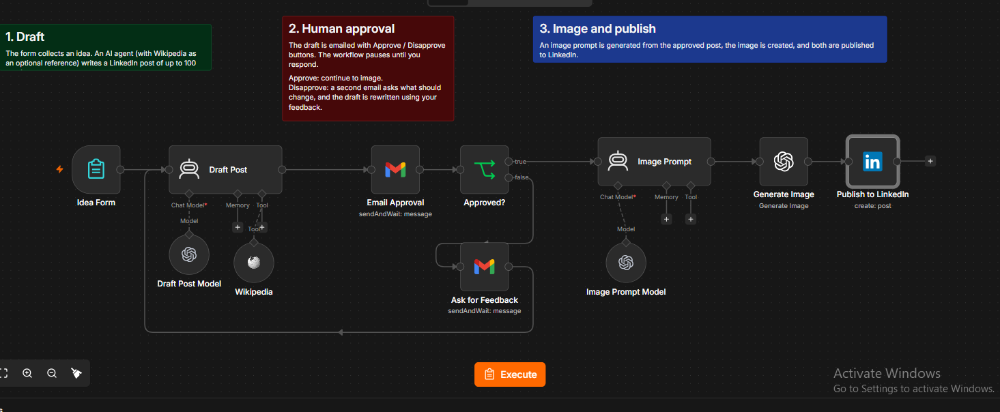
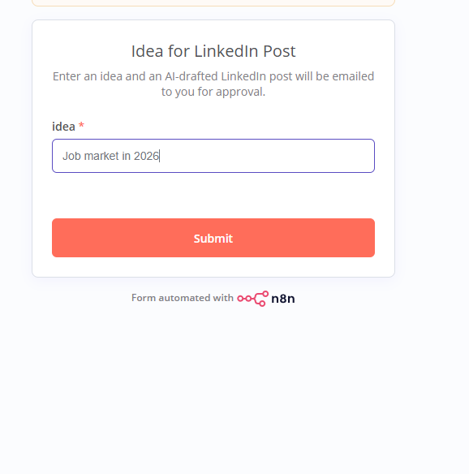
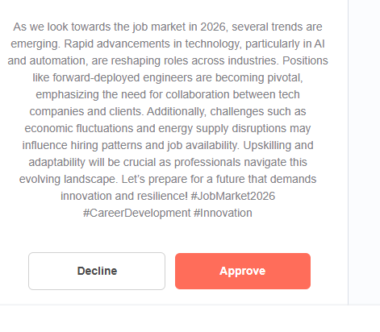
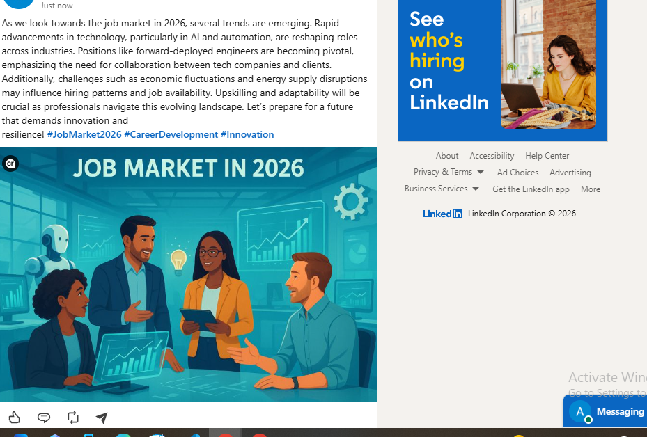

# LinkedIn Post Generator with Human Approval

An **n8n** workflow that turns a one-line idea into a published LinkedIn post. AI drafts the post, a human approves it by email, and only then does the workflow generate a matching image and publish both to LinkedIn.

## The problem

Fully automated social posting is risky, because one bad draft goes public. Fully manual posting is slow. This workflow sits in the middle: AI does the drafting and the design work, and a human keeps the final say with one click in their inbox (human-in-the-loop).

## Workflow overview



1. **Draft:** A form collects an idea. An AI agent writes a LinkedIn post of up to 100 words, using Wikipedia as an optional fact reference.
2. **Human approval:** The draft is emailed with Approve and Disapprove buttons, and the workflow pauses until you respond. If you disapprove, the draft is regenerated and sent again.
3. **Image and publish:** After approval, a second AI agent writes an image prompt from the post, an image is generated, and the post plus image are published to LinkedIn.

## Demo

### 1. Submit an idea



### 2. Review the draft by email

The AI-written draft arrives in Gmail. Nothing is published until you click **Approve**.



### 3. Published on LinkedIn

The post goes live with an AI-generated image that matches its content.



## Nodes used

| Node | Purpose |
| --- | --- |
| Idea Form (Form Trigger) | Collects the post idea |
| Draft Post (AI Agent) | Writes the LinkedIn post, with Wikipedia as a tool |
| Draft Post Model (OpenAI, `gpt-4o-mini`) | Language model for the drafting agent |
| Wikipedia (Tool) | Optional fact reference |
| Email Approval (Gmail, Send and Wait) | Emails the draft and pauses until approved or disapproved |
| Approved? (If) | Approved goes to the image step, disapproved goes back to drafting |
| Image Prompt (AI Agent) | Turns the approved post into an image prompt |
| Image Prompt Model (OpenAI, `gpt-4o-mini`) | Language model for the image prompt agent |
| Generate Image (OpenAI, `gpt-image-1-mini`) | Creates the image |
| Publish to LinkedIn (LinkedIn) | Posts the text and image |

## Tech stack

- n8n
- OpenAI (`gpt-4o-mini`, `gpt-image-1-mini`)
- Gmail (approval email)
- LinkedIn API (publishing)
- Wikipedia tool

## Repository structure

```
.
├── LinkedIn_Post_Generator_with_Human_Approval.json   # n8n workflow export
├── README.md
└── screenshots/
    ├── Capture.PNG    # workflow canvas
    ├── Form.PNG       # idea form
    ├── Gmail.PNG      # approval email
    └── Linkden.PNG    # published post
```

## Setup

1. Import the JSON into n8n: **Workflows > Import from file**.
2. Add your own credentials:
   - **OpenAI:** Draft Post Model, Image Prompt Model, Generate Image
   - **Gmail (OAuth2):** Email Approval
   - **LinkedIn (OAuth2):** Publish to LinkedIn
3. In **Email Approval**, replace `YOUR_EMAIL@example.com` with the address that should receive drafts.
4. In **Publish to LinkedIn**, replace `YOUR_LINKEDIN_PERSON_ID` with your LinkedIn person ID.
5. Run it from the form, or activate the workflow and share the form's production URL.

> Credentials are not included in this repo. You must connect your own accounts.

## Possible improvements

- Let the reviewer send feedback with a disapproval, so the next draft improves instead of being regenerated blindly.
- Cap the number of regeneration loops to avoid endless retries.
- Add an error branch that notifies you if image generation or publishing fails.
- Add tone or audience fields to the form (for example, founder voice vs. company page).

## Author

Ashna Younas
