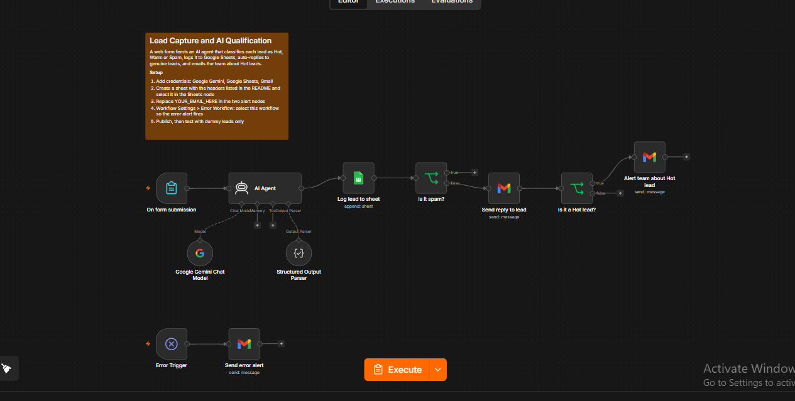
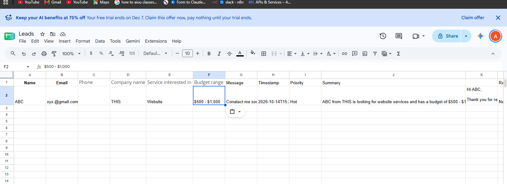
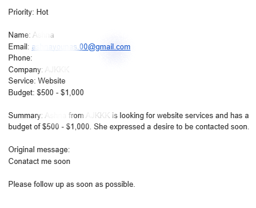

# Lead Capture and AI Qualification (n8n)

An n8n workflow that turns a website contact form into an automated lead pipeline. An AI agent classifies each lead as **Hot**, **Warm** or **Spam**, writes a short summary and a draft reply, logs everything to Google Sheets, replies to genuine leads, and emails the team immediately about Hot leads.

The demo business, "Brightpath Digital Marketing", is fictional.

## How it works
1. **Form** collects name, email, phone, company, service, budget range and message
2. **AI Agent** (Google Gemini) returns structured JSON: `priority`, `summary`, `reply_draft`
3. **Google Sheets** logs every lead, including spam, as a new row
4. **Spam check:** spam leads stop here and get no reply
5. **Auto-reply** is emailed to Hot and Warm leads
6. **Hot-lead alert** emails the team with the lead's details and summary
7. **Error workflow** emails the owner if any step fails

## Screenshots
**Workflow canvas**

**Leads logged in Google Sheets (dummy data)**

**Hot-lead alert email**

## Safety features
- The prompt treats form content as data and ignores instructions written inside a lead's message (prompt-injection guard)
- Spam leads are logged but never emailed
- Structured output with a JSON schema keeps the AI's answer predictable
- Works with typos and Roman Urdu messages, replying in English

## Tech used
n8n, Google Gemini API, Google Sheets, Gmail

## Setup
1. Import `workflow.json` in n8n (Import from file)
2. Add your own credentials: Google Gemini (API key), Google Sheets and Gmail. No credentials are stored in this file.
3. Create a Google Sheet with these headers in row 1:
   `Name, Email, Phone, Company name, Service interested in, Budget range, Message, Timestamp, Priority, Summary, Reply draft, Status`
4. Select that sheet in the **Log lead to sheet** node
5. Replace `YOUR_EMAIL_HERE` in **Alert team about Hot lead** and **Send error alert**
6. In the workflow's Settings, set **Error Workflow** to this workflow so the error alert fires
7. Publish, open the form's Production URL, and test with dummy leads such as "Sara, sara@test.com"

## Known limits
- AI replies are sent automatically without human review. For real clients, add an approval step, at least for Hot leads.
t

